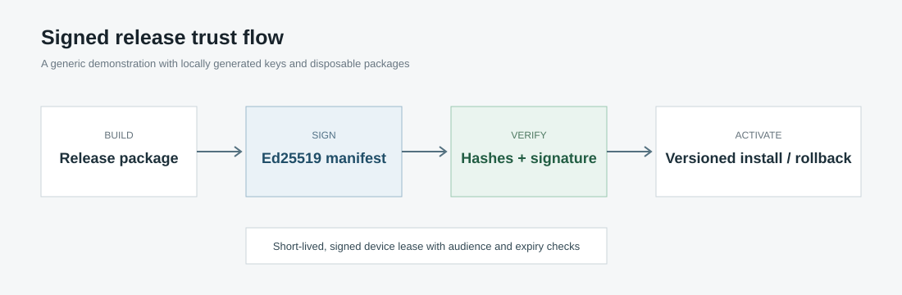

# Signed Release Trust Demo

[English / README principal](README.md) · Português (Brasil)

Uma demonstração de segurança focada em manifestos de versões assinados com Ed25519, instalação verificada, ativação atômica, reversão para a versão anterior e autorizações temporárias de curta duração vinculadas a dispositivos.



## O que demonstra

- JSON canônico antes da assinatura.
- Geração de chaves, assinatura e verificação com Ed25519.
- Validação de SHA-256 e tamanho por arquivo.
- Rejeição de conteúdos ausentes, modificados ou com caminhos que escapam do diretório permitido.
- Instalação versionada com atualizações atômicas de estado.
- Reversão em uma etapa para a versão anterior verificada.
- Autorizações temporárias vinculadas a dispositivos, com verificações de destinatário, nonce e expiração.

## Início rápido

```bash
python -m pip install -e .
python -m trustdemo.cli keys demo-workspace/keys
```

Crie um diretório de pacote contendo pelo menos um arquivo e, em seguida, execute:

```bash
python -m trustdemo.cli sign-release demo-workspace/package 1.0.0 demo-workspace/keys/private.pem
python -m trustdemo.cli verify-release demo-workspace/package demo-workspace/keys/public.pem
python -m trustdemo.cli install demo-workspace/package demo-workspace/install demo-workspace/keys/public.pem
```

## Teste

```bash
python -m pip install pytest
pytest -q
```

## Limites de segurança

Este repositório é uma implementação independente para uma aplicação fictícia. Não contém automação de jogos, código de injeção, lógica de contorno de proteções, indicadores de detecção, chaves de assinatura de produção, contas de clientes, código de pagamento ou material proprietário de versões. As chaves privadas e os ambientes de trabalho da demonstração são ignorados pelo Git.

## Licença

MIT
